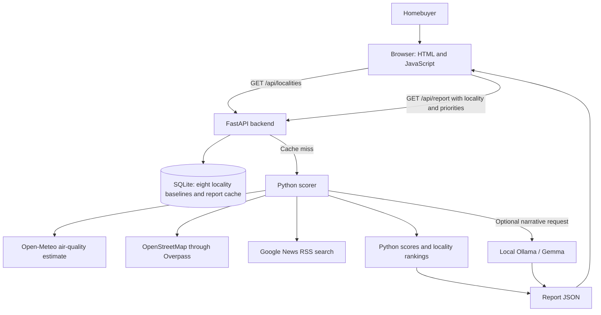

# LocaleIQ

A priority-based neighborhood audit for homebuyers comparing Gurugram localities.

## Problem statement

Buying a home means choosing more than a building. A buyer also needs to understand the surrounding neighborhood: access to schools and healthcare, air quality, utilities, water and drainage, transport, safety information, and possible infrastructure changes.

That information is spread across different sources, uses different formats, and can be difficult to compare. Property listings and informal claims do not always make it clear which figures are current, which are estimates, or where the information came from. LocaleIQ addresses this information gap by bringing selected neighborhood indicators into one report and showing how the areas compare for a buyer’s chosen needs.

## Solution

LocaleIQ is a web application that creates a concise, priority-weighted report for a selected Gurugram locality. It combines locally stored baseline values with public data sources when available, calculates six neighborhood ratings in Python, and compares the selected area with seven other seeded localities.

Buyers can select more than one household priority, such as children and elders, because real households may have several needs at the same time. The report shows an overall score, six pillar ratings, available readings, brief explanations, and separate “best overall match” and “best value” comparisons.

LocaleIQ is a decision-support and transparency tool, not a guarantee about a property or neighborhood. The displayed values are estimates or public information where available and are not verified by a government body. The report should be considered alongside independent checks and an in-person assessment.

## What the application does

- Covers eight seeded Gurugram localities: DLF Phase 4, Golf Course Road, Golf Course Extension Road, Sohna Road, Sushant Lok Phase 1, Dwarka Expressway, New Gurugram, and Palam Vihar.
- Lets users combine nine priorities: children, elders, commuter, air-sensitive, remote work, water resilience, safety first, long-term infrastructure, and price context.
- Produces six ratings: schools and healthcare, safety estimate, power reliability, transit and infrastructure, water and drainage, and air quality.
- Ranks all eight localities using the selected priority weights and calculates a separate score-per-price value ranking.
- Shows data-source status, retrieval times when available, and notes about unconfirmed or stored values.
- Uses local Gemma through Ollama for selected personalized explanations and comparison trade-off prose. Python remains responsible for the numeric scores and rankings.
- Falls back to deterministic rule-based explanations when Gemma is disabled, unavailable, or returns a response the application cannot use.

## How to use LocaleIQ

### Run the website locally

The frontend is served by the FastAPI application, so for local use you do not need to start a separate frontend server.

From the repository root, create and activate a Python virtual environment, install the backend requirements, and start the app:

```bash
python3 -m venv .venv
source .venv/bin/activate
python -m pip install --upgrade pip
python -m pip install -r backend/requirements.txt
python -m uvicorn main:app --app-dir backend --reload --host 127.0.0.1 --port 8000
```

Open [http://127.0.0.1:8000](http://127.0.0.1:8000) in a browser. The app creates the SQLite database and inserts any missing seed localities on startup. The generated database is stored at `backend/localeiq.db` by default and is ignored by Git.

The repository’s `.python-version` currently says Python 3.12, while the GitHub Actions workflow runs Python 3.11. Use Python 3.11 to match CI, or confirm the intended project version and align these settings before relying on a different interpreter.

### Optional: enable the local Gemma model

Gemma is optional for report availability. To use it, install and start Ollama separately, and make sure the configured model is available locally. The current default model name is `gemma4:12b`; the backend sends requests to Ollama at `http://localhost:11434` by default.

You can set configuration in your shell or in a project-root `.env` file. The `.env` file is ignored by Git; do not commit credentials or private configuration.

```env
OLLAMA_ENABLED=true
OLLAMA_URL=http://localhost:11434
OLLAMA_MODEL=gemma4:12b
OLLAMA_TIMEOUT_SECONDS=18
```

To run reports without attempting Gemma, set `OLLAMA_ENABLED=false`. The report will use the rule-based backup text. If Ollama is enabled but cannot be reached, the scorer also returns its fallback text.

### Common environment settings

| Setting | Default | Purpose |
| --- | --- | --- |
| `LOCALEIQ_DB_PATH` | `backend/localeiq.db` | Optional path for the SQLite database. |
| `OLLAMA_ENABLED` | `true` | Enables or disables the local Gemma request. Only the value `true`, ignoring letter case, enables it. |
| `OLLAMA_URL` | `http://localhost:11434` | Base URL for the local Ollama service. |
| `OLLAMA_MODEL` | `gemma4:12b` | Ollama model tag requested by the scorer when Gemma is enabled. |
| `OLLAMA_TIMEOUT_SECONDS` | `18` | Timeout for the Gemma request. |
| `AIR_QUALITY_API_URL` | Open-Meteo Air Quality API | Optional air-quality endpoint override. |
| `OVERPASS_API_URL` | Overpass API interpreter | Optional OpenStreetMap/Overpass endpoint override. |
| `NEWS_RSS_URL` | Google News RSS search endpoint | Optional news RSS endpoint override. |

The application uses public-source endpoints by default and does not require an AI cloud API key for Gemma. External providers can still be unavailable, rate-limited, or return incomplete data. Response time depends on those services and on the speed of the local model.

## Architecture



### Report request flow

1. The browser loads `frontend/index.html` and `frontend/app.js`. The JavaScript requests `/api/localities` to fill the locality selector.
2. The user selects a locality and any combination of priorities. The page sends a `GET /api/report` request with the locality ID and one repeated `priorities` query parameter for each selected priority.
3. FastAPI validates the selection, looks up the locality in SQLite, and checks the report cache. Invalid selections return a client error; an unknown locality returns not found.
4. On a cache miss, the backend passes the selected locality, its priority settings, and all eight locality records to the scorer. The scorer fetches available evidence for comparison areas, calculates scores and rankings in Python, and prepares a rule-based explanation.
5. If enabled, the scorer sends the supplied results and evidence to local Ollama/Gemma for selected narrative fields. It filters the response and keeps Python’s number lines. If the model call fails, the rule-based text is used.
6. The backend stores the report as JSON in the SQLite cache and returns it. The browser displays the summary cards, ratings, radar chart, and comparison sidebar, then closes the loading overlay.

The report cache is keyed by locality and the selected priority set. Reordering the same priorities does not create a different cache key. The current cache has no expiry mechanism, so a cached report may not be regenerated until its cache entry is replaced or removed.

## Scoring and comparison

The six score pillars are:

1. Schools and healthcare
2. Safety estimate
3. Power reliability
4. Transit and infrastructure
5. Water and drainage
6. Air quality

Each selected priority profile contributes a set of pillar weights. When several priorities are selected, the scorer averages those profiles and applies the resulting weights consistently across the locality comparison. The school-versus-healthcare mix is calculated separately. If no priorities are selected, the report uses balanced weights unless a legacy persona is supplied through the API.

Python calculates the overall weighted score and grade. “Best overall match” is ranked by score, with price and locality name used as tie-breakers. “Best value” uses a score-per-price comparison. This is a relative comparison, not an affordability calculation based on a buyer’s personal budget.

When some evidence is unavailable, the scorer uses a neutral value of 50 for certain affected pillars. This is a calculation fallback, not a claim that the neighborhood has been measured and found average. The police and drainage feature counts are displayed as context only; the current scorer marks them as not used in the scores.

## Data sources and transparency

LocaleIQ separates live-source attempts, stored baseline values, and calculations made by its own Python code.

| Information | Current treatment | Important limitation |
| --- | --- | --- |
| Air quality | Requests modeled AQI, PM2.5, and PM10 estimates from Open-Meteo at each locality’s coordinates. | These are modeled estimates, not readings from a local monitoring station. They may be unavailable. |
| Nearby places | Queries OpenStreetMap data through Overpass for mapped schools, healthcare, and transit within 2.5 km. | Map coverage can be incomplete or out of date; mapped presence does not establish quality or actual travel time. |
| Civic/news context | Searches Google News RSS for Gurugram-wide civic and infrastructure stories. | It is not locality-specific proof, official crime data, or confirmation that a proposed project is approved or funded. |
| Baseline values | SQLite stores average price per square foot, a safety estimate, a water score, and estimated weekly power interruptions for each seeded locality. | The current implementation does not record the original source or observation date for these baselines. The safety estimate is not calculated from recent news or official crime records. |
| Scores and rankings | Python calculates pillar scores, an overall score and grade, priority-weighted locality ranks, and a score-per-price value comparison. | These are app calculations based on the available inputs; they are not independent government assessments. |

The report includes source-status and provenance fields so the interface can distinguish available readings from unavailable checks. A source status or retrieval timestamp describes the request, not the accuracy or completeness of the underlying information.

## Data attribution and terms

- Air-quality estimates come from the Open-Meteo Air Quality API. See the [API documentation](https://open-meteo.com/en/docs/air-quality-api) and [licence information](https://open-meteo.com/en/licence). The current scorer records that the free API is for non-commercial use and that commercial use requires an appropriate provider plan. Check current provider terms before reuse.
- Nearby-place information is queried from OpenStreetMap contributors through Overpass. The scorer identifies the data as Open Database License (ODbL) data; see [OpenStreetMap copyright and attribution](https://www.openstreetmap.org/copyright). Preserve required attribution when displaying or redistributing mapped data.
- Civic headlines are discovered through Google News RSS. Treat them as contextual links or headlines, not as official verification of an event or project.

The visible data note should be read as part of every report: estimates and public information are not verified by a government body. Verify property-specific details independently before making a purchase decision.

## Gemma’s role

Gemma is the app’s language layer, not its scoring engine. The Python scorer sends the local model a structured set of already-calculated results, selected household priorities, available metrics, and—when generating a comparison—the calculated locality matrix.

Gemma can write concise, personalized explanations for the report cards and a short counterfactual trade-off explanation. The prompt instructs it to use supplied evidence, avoid technical wording and unsupported claims, and not change the official numbers. The application then normalizes the returned JSON and uses fallback text for invalid or rejected fields. Python’s number lines remain authoritative.

Gemma runs through a local Ollama service by default; the code does not call a hosted Gemma API. Local model output can still be wrong, so the filters reduce risk but do not guarantee factual correctness. If Gemma is unavailable, the app uses deterministic rule-based text.

The AI model used by the product should not be confused with AI assistants that may have contributed during development. Any development-assistance acknowledgment should accurately reflect the project’s actual history.

## API examples

The application exposes two main GET endpoints.

### List supported localities

```bash
curl http://127.0.0.1:8000/api/localities
```

This returns locality IDs, display names, and listed average price per square foot.

### Generate a report

```bash
curl --get 'http://127.0.0.1:8000/api/report' \
  --data-urlencode 'locality_id=dlf_phase_4' \
  --data-urlencode 'priorities=children' \
  --data-urlencode 'priorities=elders'
```

The `priorities` parameter is repeatable so a household can select more than one option. A legacy `persona` query parameter is also accepted by the API when no priorities are supplied, but the current interface uses the multi-select priorities.

The example request and a representative response are in `examples/sample_input.json` and `examples/sample_output.json`. The sample output is a fixture, not a guaranteed current report; it shows unavailable live sources and fallback insight rather than a live Gemma result.

## Run the tests

Install the backend dependencies if you have not already, activate the project virtual environment, then run:

```bash
PYTHONPATH=backend python -m unittest discover -s backend -p 'test_*.py' -v
```

The backend test suite contains 16 tests across API and scorer behavior. The tests cover selected priority and cache cases, scoring and comparison examples, fallback wording, mocked data-source errors, and mocked Gemma prompt/response handling. Mocked tests are useful for repeatable checks, but they do not prove that live providers are accurate or available.

GitHub Actions runs on pushes and pull requests. It installs Python 3.11, compiles the named backend Python files, checks that both example files parse as JSON, and runs backend unittest discovery. Note that the CI Python version currently differs from the repository’s `.python-version` declaration of 3.12.

## Project structure

```text
.
├── .github/
│   ├── pull_request_template.md
│   └── workflows/
│       └── ci.yml
├── backend/
│   ├── main.py
│   ├── scorer.py
│   ├── test_api.py
│   ├── test_scorer.py
│   └── requirements.txt
├── examples/
│   ├── sample_input.json
│   └── sample_output.json
├── frontend/
│   ├── app.js
│   └── index.html
├── app.py
├── HACKATHON.md
├── LICENSE
├── README.md
├── requirements.txt
└── .python-version
```

`backend/main.py` defines the FastAPI app, routes, SQLite initialization, and cache. `backend/scorer.py` handles evidence fetching, priority weighting, score calculation, comparisons, narrative generation, and provenance. `frontend/index.html` defines the page; `frontend/app.js` requests and renders report data. `app.py` is a small root-level ASGI entrypoint wrapper; the local command above runs the backend module directly. The root `requirements.txt` is maintained for deployment tooling; local setup uses `backend/requirements.txt`.

The SQLite database, Python virtual environment, and Python cache files are generated locally and are not part of the source tree shown above.

## Known limitations and safe use

- The current product covers eight seeded localities, not every neighborhood in Gurugram.
- The original source and observation date for stored price, safety, water, and power baselines are not recorded in the current implementation.
- Air values are modeled estimates. Mapped facilities may be incomplete or stale, and the news search is city-wide.
- Missing evidence can trigger a neutral scoring fallback; it must not be represented as a verified measurement.
- The current report cache has no expiry mechanism.
- Gemma-generated text is constrained but not guaranteed to be correct; numeric results come from Python calculations.
- The current FastAPI code allows all CORS origins and does not provide user authentication. Treat this as a local hackathon prototype; review security, access control, deployment configuration, and data handling before exposing it publicly.
- The report is for transparency and comparison, not financial, legal, safety, or property-purchase advice.

## Contributing

1. Create a branch for your change.
2. Make the change and add or update tests where appropriate.
3. Run the backend test command above.
4. Open a pull request and complete `.github/pull_request_template.md`, including affected areas, product-model usage, data/scoring changes, testing, and known limitations.
5. Describe any live-source or stored-baseline changes clearly, and distinguish product runtime models from development tools.

## License

See `LICENSE` for the project’s reuse permissions, notice requirements, and warranty/liability wording.
